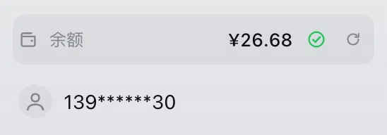
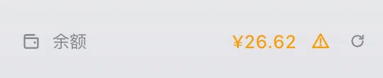
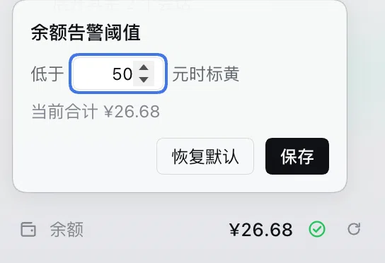

# dsh-avatar-balance

DeepSeek account balance in the sidebar foot, directly above the account avatar.

English | [中文](README.zh.md)

A full-width row shows the balance with a status mark: amber ⚠ while the total (top-up + bonus) is below the threshold, green ✓ above it. Click the mark to change the threshold (default 20, saved locally). Hover for the breakdown; a collapsed sidebar shows a round wallet button instead. Hidden while signed out.





## Install

Settings → Plugins → Install:

```
github:adrian-atlas/dsh-avatar-balance
```

DeepSeek Harness 0.2.1-rc.3+ and a DeepSeek account.

## Refresh

- on load
- 3 seconds after any task finishes
- every 2 minutes while the page is visible
- when the window regains focus
- on ⟳

The balance is account-wide, shared by every session.

## License

MIT
